# Movie Backend

A Kotlin + Spring Boot backend for the movie app. It serves the movies list, paging and search, and lets an admin edit a movie. Every real edit sends a push notification (FCM) so the Android app can update its local cache straight away.

**What it does**

- Serves movies: list, search and details (`/api/movies`).
- Fills its database from TMDb on startup. With no TMDb key (or if TMDb fails) it uses 25 sample movies.
- Lets an admin edit a movie from Swagger UI, Postman or a web portal. TMDb re-syncs never overwrite an edited movie.
- Sends an FCM push **only when the content really changed**.

**Stack:** Kotlin 2.3, Spring Boot 4.1, Java 17, PostgreSQL (H2 for local use), Spring Security, Thymeleaf, Firebase Admin SDK, Docker Compose.

**Contents**

1. [Run it locally](#1-run-it-locally)
2. [API keys and configuration](#2-api-keys-and-configuration)
3. [Using the backend](#3-using-the-backend)
4. [When is a push sent, and what does it contain?](#4-when-is-a-push-sent-and-what-does-it-contain)
5. [Android integration guide](#5-android-integration-guide)
6. [Architecture and decisions](#6-architecture-and-decisions)
7. [Tests and project layout](#7-tests-and-project-layout)
8. [Troubleshooting](#8-troubleshooting)

---

## 1. Run it locally

Follow the steps in order. You do not need a TMDb key or a Firebase file to start: without them the backend uses 25 sample movies and only logs the push. You can add both later (section 2).

### Which way should I run it?

| Way | You need | Choose it when |
|---|---|---|
| **A. Setup script** | Docker Desktop | You want the easiest start (recommended) |
| **B. Docker by hand** | Docker Desktop | You want to see and run each command yourself |
| **C. Without Docker** | JDK 17 | You cannot use Docker. Uses a small file database instead of Postgres |

### Step 0: Before you start

1. **Get the code** and open a terminal in the project folder:
   ```bash
   git clone https://github.com/abdelra7man257/TrianglzMovieBackEnd.git
   cd TrianglzMovieBackEnd
   ```
2. **Install what you need** and check it works:

   | For | Install | Check with | You should see |
   |---|---|---|---|
   | A and B | [Docker Desktop](https://www.docker.com/products/docker-desktop) (start it and wait until it says it is running) | `docker --version` and `docker compose version` | a version number for each |
   | C | **JDK 17**, for example from [adoptium.net](https://adoptium.net). The build asks for Java 17 exactly, so having only a newer Java (21, 25) is **not enough**. Several Java versions side by side is fine | `java -version` (or `/usr/libexec/java_home -V` on macOS, `dir "C:\Program Files\Java"` on Windows) | `17` in the version, or in the list of installed Javas |

3. **Free the ports.** The backend uses port **8080** (API) and **5432** (database, Docker only). If another program uses them, you can change them in `.env` later (see "If a port is already used" below).
4. **Internet is needed** on the first run (downloads Docker images, Gradle and libraries).

### A. Setup script (recommended)

| System | How to run it |
|---|---|
| Windows | Double-click `setup-and-run.bat` (or run it in a terminal) |
| macOS / Linux | In the terminal, in the project folder: `./setup-and-run.sh` |

1. Run the script. A menu appears. Choose **1** (Setup and start with Docker).
2. The first time it creates a `.env` settings file and asks: `TMDb API key (v3):`. Paste your key, or press **Enter** to skip and use sample movies. (How to get a key: [section 2](#get-a-tmdb-key).)
3. If there is a Firebase file in the `secrets/` folder, the script uses it automatically. If not, it says push notifications will only be logged.
4. It builds and starts the backend and waits until it is healthy. **The first run takes a few minutes.**
5. When it is ready it prints the addresses and opens Swagger UI in your browser:
   ```
   ===================== The backend is running =====================
     Swagger UI    http://localhost:8080/swagger-ui.html
     API           http://localhost:8080/api/movies
     Admin portal  http://localhost:8080/admin/movies   (admin / admin123)
     Android app   http://10.0.2.2:8080/api/   (from the emulator)
   ```
6. Go to [Check that it works](#check-that-it-works).

You can skip the menu by adding an option: `docker`, `local` (no Docker), `stop`, `logs` or `open`. For example `./setup-and-run.sh stop`.

### B. Docker by hand

1. **Create your settings file** from the template:
   ```bash
   cp .env.example .env          # Windows (cmd): copy .env.example .env
   ```
2. **Edit `.env`** (optional). To get real movies, set your key on the line `TMDB_API_KEY=` (no spaces around `=`). Leave everything else as it is for now.
3. **Start everything** (database and backend):
   ```bash
   docker compose up --build
   ```
   The first run downloads images and builds the app, which takes a few minutes.
4. **Wait until the backend is ready.** Look for these lines in the log:
   ```
   TMDb sync: 200 movies imported          (or: Seeded 25 dummy movies)
   Started TrianglzMovieBackEndApplicationKt in ... seconds
   ```
   Leave this terminal open. It shows the log. Press **Ctrl+C** to stop.
   *(Tip: use `docker compose up --build -d` to run in the background, then `docker compose logs -f api` to read the log.)*
5. Go to [Check that it works](#check-that-it-works).

### C. Without Docker

This uses a file database in the `data/` folder (git-ignored) and needs JDK 17 (see step 0).

1. **Create your settings file** (needed only if you want a TMDb key, otherwise skip to step 3):
   ```bash
   cp .env.example .env          # Windows (cmd): copy .env.example .env
   ```
2. **Load the settings into your terminal** (optional, so the TMDb key is used):

   | System | Command |
   |---|---|
   | macOS / Linux | `set -a; . ./.env; set +a` |
   | Windows (cmd) | `set TMDB_API_KEY=<your key>` |
   | Windows (PowerShell) | `$env:TMDB_API_KEY="<your key>"` |

   Do **not** load `FIREBASE_CREDENTIALS_PATH=/secrets/...` from `.env`. That path only exists inside Docker, and a wrong path stops the app at startup. Without Docker, either leave it empty or set it to the real file path.
3. **Start the backend:**

   | System | Command |
   |---|---|
   | macOS / Linux | `./gradlew bootRun --args='--spring.profiles.active=local'` |
   | Windows | `gradlew.bat bootRun --args="--spring.profiles.active=local"` |

   The first run downloads Gradle and libraries, which takes a few minutes. The easy alternative is the script: `./setup-and-run.sh local` (macOS / Linux) or `setup-and-run.bat local` (Windows). It loads `.env` for you and fixes the Firebase path.
4. **Wait for** `Started TrianglzMovieBackEndApplicationKt` in the log. Press **Ctrl+C** to stop.
5. Go to [Check that it works](#check-that-it-works).

### Check that it works

Use port 8080, or your `API_PORT` if you changed it.

| # | Check | How | You should see |
|---|---|---|---|
| 1 | The backend is healthy | Open <http://localhost:8080/actuator/health> | `{"status":"UP", ...}` |
| 2 | Movies are loaded | Open <http://localhost:8080/api/movies?size=2> | JSON with `total_results` of about **200** (real TMDb data) or **25** (sample data) |
| 3 | Search works | Open <http://localhost:8080/api/movies/search?query=the> | JSON with matching movies |
| 4 | Swagger UI opens | Open <http://localhost:8080/swagger-ui.html> | The API page with 4 endpoints |
| 5 | The admin portal works | Open <http://localhost:8080/admin/movies>, sign in with `admin` / `admin123` | The movie list with posters |
| 6 | Editing works | In Swagger UI click **Authorize** (`admin` / `admin123`), then `PATCH /api/movies/{id}` with `{"title": "Test"}` | `200` and the movie with the new title. The log shows `FCM log-only mode` (or `FCM sent` if Firebase is set up) |

If all six work, the backend is ready. For the Android app see [section 5](#5-android-integration-guide).

### Everyday commands

| I want to... | Docker (A or B) | Without Docker (C) |
|---|---|---|
| Stop | `docker compose down` (or `./setup-and-run.sh stop`) | Press **Ctrl+C** |
| Start again | `docker compose up -d` | Run the start command again |
| Read the log | `docker compose logs -f api` | It is in the terminal |
| Use my new code after a `git pull` | `docker compose up --build -d` | Stop and start again |
| Start with fresh data | `docker compose down -v` (deletes the database), then start | Delete the `data/` folder, then start |
| Run the tests | `./gradlew test` (Windows: `gradlew.bat test`) | same |

Your data stays between stops. Only `docker compose down -v` or deleting `data/` removes it.

### If a port is already used

An error like `port is already allocated` (Docker) or `Port 8080 was already in use` means another program uses the port.

1. Open `.env`.
2. Change the port, for example `API_PORT=8081` and/or `DB_PORT=5433`.
3. Start again, and use the **new port in every address** in this file (the Android emulator then uses `http://10.0.2.2:8081/api/`).

For other problems see [Troubleshooting](#8-troubleshooting).

---

## 2. API keys and configuration

The backend needs up to three things. All of them are optional for a first run.

| What | Needed for | Where it goes |
|---|---|---|
| TMDb API key | Real movies (without it you get 25 sample movies) | `TMDB_API_KEY` in `.env` |
| Firebase service-account file | Real push notifications (without it the push is only logged) | `secrets/` folder + `FIREBASE_CREDENTIALS_PATH` in `.env` |
| Admin login | Editing movies and the admin portal | `ADMIN_USERNAME` / `ADMIN_PASSWORD` in `.env` |

All settings are environment variables (put them in `.env`). Nothing secret is committed: `.env`, `secrets/`, `data/` and `google-services.json` are git-ignored.

| Variable | Default | What it does |
|---|---|---|
| `TMDB_API_KEY` | empty | TMDb v3 key. Empty means sample data. The key stays on the server. |
| `TMDB_SYNC_PAGES` | `10` | Pages to import (20 movies each, so 200). |
| `DB_USERNAME` / `DB_PASSWORD` | `movies` / `movies` | Database login (Docker). |
| `DB_PORT` | `5432` | Postgres port on your machine (Docker). |
| `API_PORT` | `8080` | API port on your machine (Docker). |
| `FIREBASE_CREDENTIALS_PATH` | empty | Firebase service-account file. Empty means the push is only logged. |
| `FCM_TOPIC` | `movie-updates` | Topic the Android app subscribes to. |
| `ADMIN_USERNAME` / `ADMIN_PASSWORD` | `admin` / `admin123` | Login for editing and the portal. **Change these outside local use.** |

### Get a TMDb key

1. Create a free account at <https://www.themoviedb.org>.
2. Go to Settings → API and request a key.
3. Put the **API Key (v3)** in `.env` as `TMDB_API_KEY=...`.

### Set up Firebase (for real push notifications)

1. Create a project at <https://console.firebase.google.com> and add your Android app (its package name).
2. Download `google-services.json` and keep it for the Android app (do not commit it).
3. In Firebase: Project settings → Service accounts → **Generate new private key**. Save the file in the `secrets/` folder of this project.
4. In `.env` set the path **as seen inside Docker**:
   ```
   FIREBASE_CREDENTIALS_PATH=/secrets/<your file name>.json
   ```
5. Restart: `docker compose up -d`.

Without this the backend still works. When you edit a movie it only logs `FCM log-only mode ...`.

---

## 3. Using the backend

Default port 8080 (use your `API_PORT` if you changed it).

| What | URL |
|---|---|
| Swagger UI (try the API) | <http://localhost:8080/swagger-ui.html> |
| API | <http://localhost:8080/api/movies> |
| Admin portal | <http://localhost:8080/admin/movies> |
| Health check | <http://localhost:8080/actuator/health> |
| From the Android emulator | `http://10.0.2.2:8080/api/` |

### API

| Method | Path | Login needed | What it does |
|---|---|---|---|
| GET | `/api/movies?page=1&size=20` | no | Movies, most popular first |
| GET | `/api/movies/search?query=lion&page=1&size=20` | no | Search by title (case-insensitive, partial) |
| GET | `/api/movies/{id}` | no | One movie |
| PATCH | `/api/movies/{id}` | yes (Basic) | Edit a movie |

Paging: `page` starts at 1. `size` is 1 to 50. Values outside this are corrected. A blank search returns an empty page, not an error. There is a next page while `page < total_pages`.

**A movie** (all names are snake_case):

```json
{
  "id": 550,
  "title": "Fight Club",
  "overview": "A ticking-time-bomb insomniac...",
  "poster_path": "/pB8BM7pdSp6B6Ih7QZ4DrQ3PmJK.jpg",
  "backdrop_path": "/hZkgoQYus5vegHoetLkCJzb17zJ.jpg",
  "release_date": "1999-10-15",
  "vote_average": 8.4,
  "vote_count": 27000,
  "popularity": 61.4,
  "genres": ["Drama", "Thriller"],
  "updated_at": "2026-11-06T19:10:00Z"
}
```

- `id` is the TMDb id.
- `overview`, `poster_path`, `backdrop_path` and `release_date` can be `null`.
- Image paths are relative: image URL = `https://image.tmdb.org/t/p/w500` + `poster_path`.
- `genres` are names (not ids) and can be empty.
- `updated_at` changes whenever the movie is edited.

A list or search returns `{ "page": 1, "results": [ ...movies... ], "total_pages": 10, "total_results": 200 }`.

**Edit a movie** — send only the fields you want to change (at least one):

```bash
curl -u admin:admin123 -X PATCH http://localhost:8080/api/movies/550 \
  -H 'Content-Type: application/json' \
  -d '{"title": "Fight Club (Edited)", "vote_average": 9.1}'
```

| Field | Rules |
|---|---|
| `title` | 1 to 255 characters, not blank |
| `overview` | up to 5000 characters |
| `poster_path` | text |
| `release_date` | `yyyy-MM-dd` |
| `vote_average` | 0 to 10 |
| `genres` | list of names, up to 10 |

**Errors** always look like this:

```json
{ "status": 404, "error": "Not Found", "message": "Movie with id 999 not found", "details": [], "timestamp": "2026-11-06T19:10:00Z" }
```

| Status | When |
|---|---|
| 400 | Invalid value (`details` lists `field: message`), empty edit, bad JSON, bad parameter |
| 401 | Missing or wrong login on an edit |
| 404 | Movie not found |
| 500 | Unexpected error (generic message, details only in the server log) |

**Other ways to call the API**

- **Swagger UI:** click **Authorize**, enter the admin login, then use `PATCH /api/movies/{id}`.
- **Postman:** import `postman/MovieBackend.postman_collection.json` and set the `baseUrl` variable.
- **IntelliJ / VS Code:** open `api.http` (settings in `http-client.env.json`).

### Admin portal: every edit operation

The portal is a small web app for editing movies. Open <http://localhost:8080/admin/movies> (use your `API_PORT`). It uses the admin login from `.env` (default `admin` / `admin123`).

**What you can and cannot do**

| You can | You cannot |
|---|---|
| Sign in and sign out | Create a movie |
| Browse all movies, 20 per page | Delete a movie |
| Search by title | Change `id`, `backdrop_path`, `vote_count` or `popularity` |
| Edit title, overview, poster path, release date, rating and genres | Clear the release date (leave it as is) |

**1. Sign in** — `/login`. Any `/admin/...` page sends you here if you are not signed in.

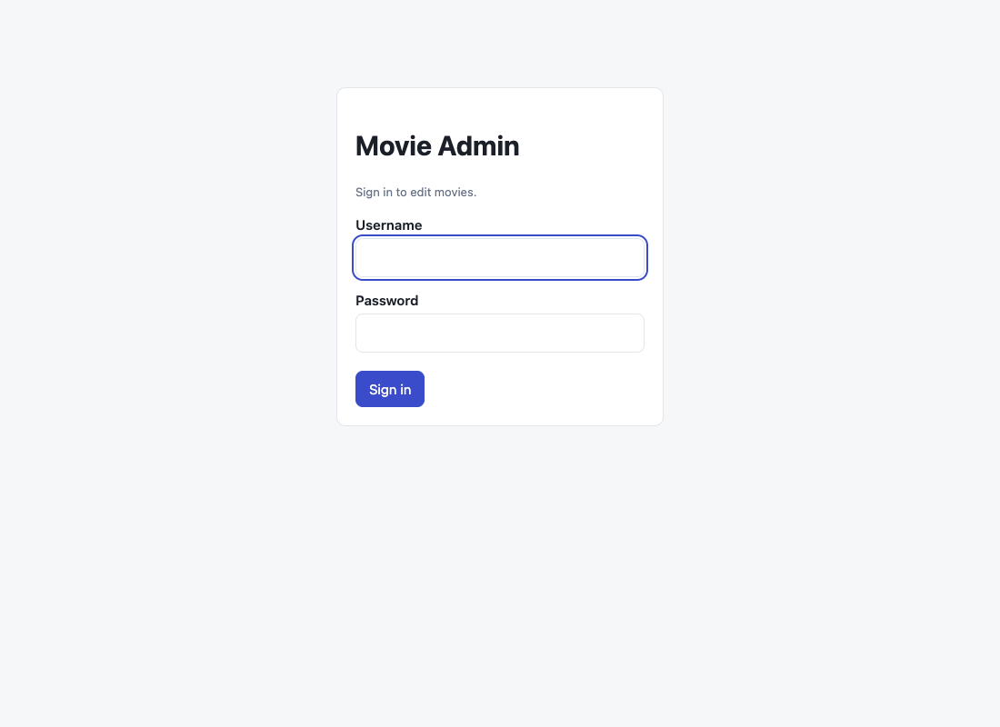

| Result | What you see |
|---|---|
| Correct login | The movie list |
| Wrong login | `Wrong username or password.` |
| After signing out | `You have been signed out.` |

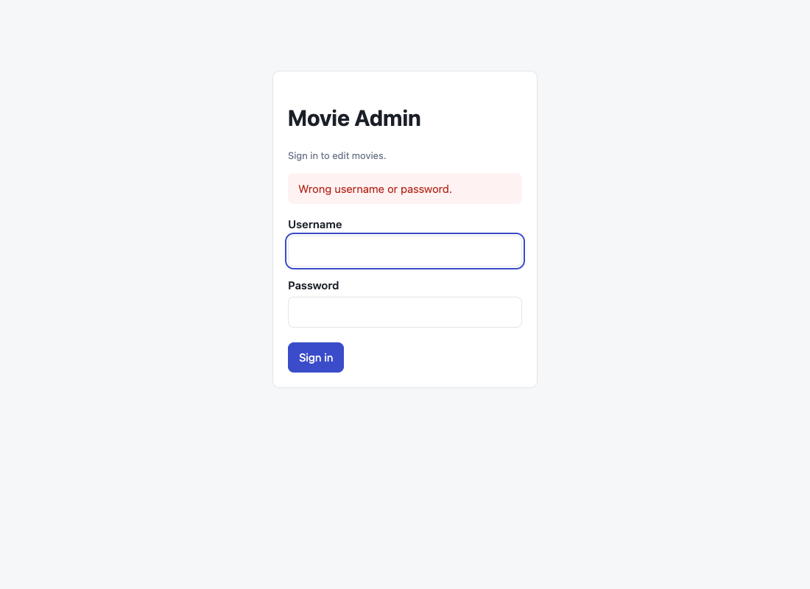

**2. Browse the list** — `/admin/movies`.

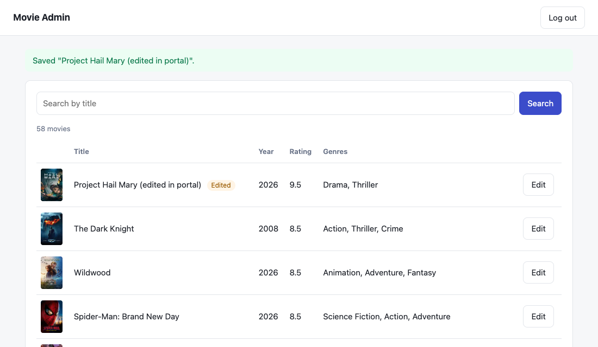

*The list right after a save: the green message on top, and the **Edited** badge on the changed movie.*

- Shows poster, title, year, rating and genres. A movie an admin changed has an **Edited** badge.
- Shows the total (`1 movie` / `N movies`) and `Page X of Y`. **Previous** and **Next** appear only when there is another page.
- No matches shows `No movies found.`

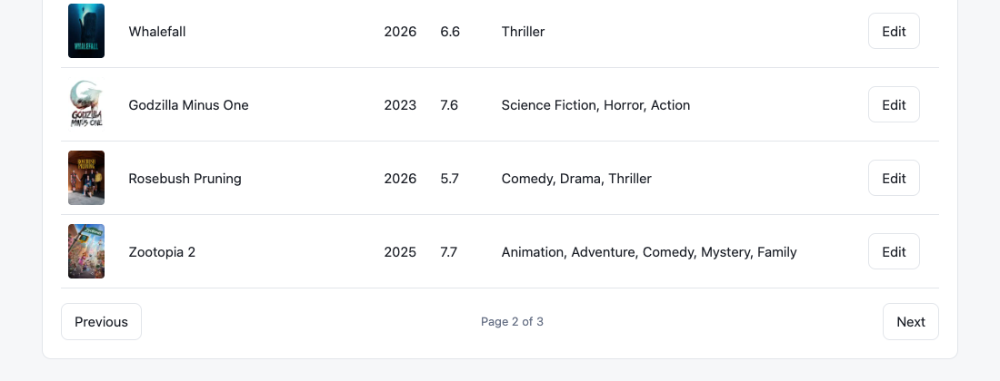

**3. Search** — type part of a title and press **Search**. It is not case-sensitive and matches any part of the title. The search text stays in the box while you page through the results. **Clear** shows all movies again.

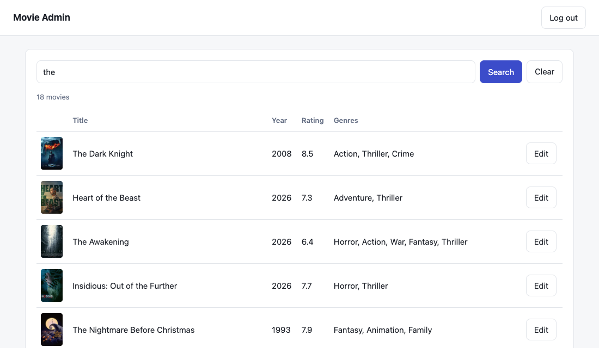

**4. Open the edit form** — click **Edit** on a row (`/admin/movies/{id}/edit`). The form is filled with the current values.

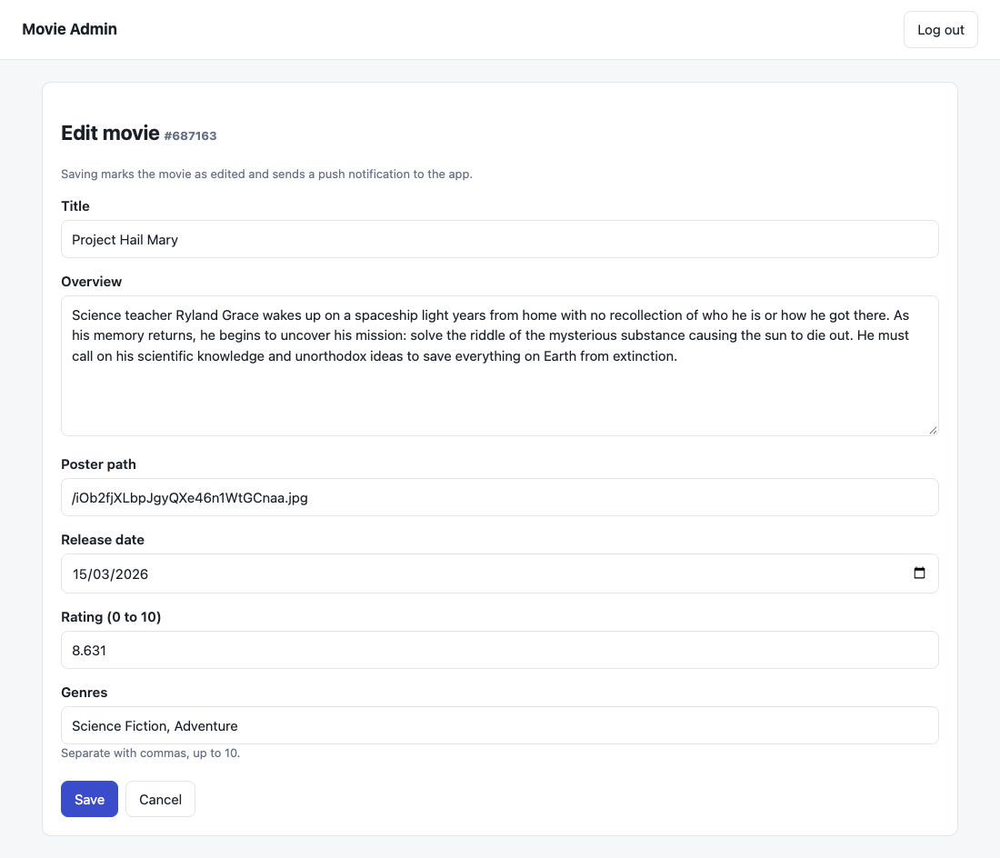

| Field | What to enter | Rules and error message |
|---|---|---|
| Title | Text | Required: `Title is required`. At most 255 characters: `Title must be at most 255 characters` |
| Overview | Multi-line text | At most 5000 characters: `Overview must be at most 5000 characters`. Empty it to clear the overview |
| Poster path | Path such as `/abc.jpg` | At most 255 characters: `Poster path must be at most 255 characters`. Empty it to clear |
| Release date | Date picker, `yyyy-MM-dd` | A wrong date format is rejected. Leaving it blank keeps the current date |
| Rating | Number 0 to 10 (step 0.1) | Required: `Rating is required`. Outside 0 to 10: `Rating must be between 0 and 10` |
| Genres | Names separated by commas | At most 10: `At most 10 genres`. Too long: `Genres text is too long`. Empty it to remove all genres |

Example: a real edit, with a new title, rating and genres filled in:

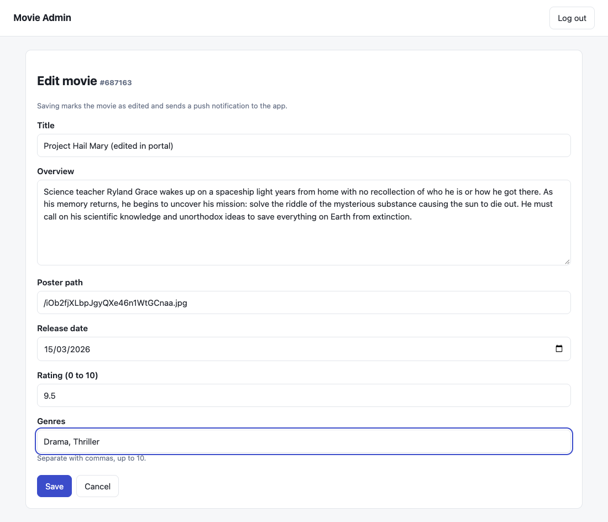

**5. Save** — press **Save**. Possible results:

| What happened | Result |
|---|---|
| The content really changed | Back to the list with `Saved "<title>".`. The movie has the **Edited** badge, its `updated_at` changes, and **a push is sent** to the app |
| Nothing really changed (same values, extra spaces, genres in another order) | Back to the list with the **same** `Saved "<title>".` message. **Nothing is stored and no push is sent**, and no Edited badge is added (see section 4) |
| A field is invalid | The form opens again with the error message under each wrong field. **Nothing is saved** and no push is sent |
| The movie no longer exists | Back to the list with `Movie with id <id> not found` |
| Your session ended | You are sent to the login page |

An invalid save (empty title, rating 11) shows the messages under the fields and saves nothing:

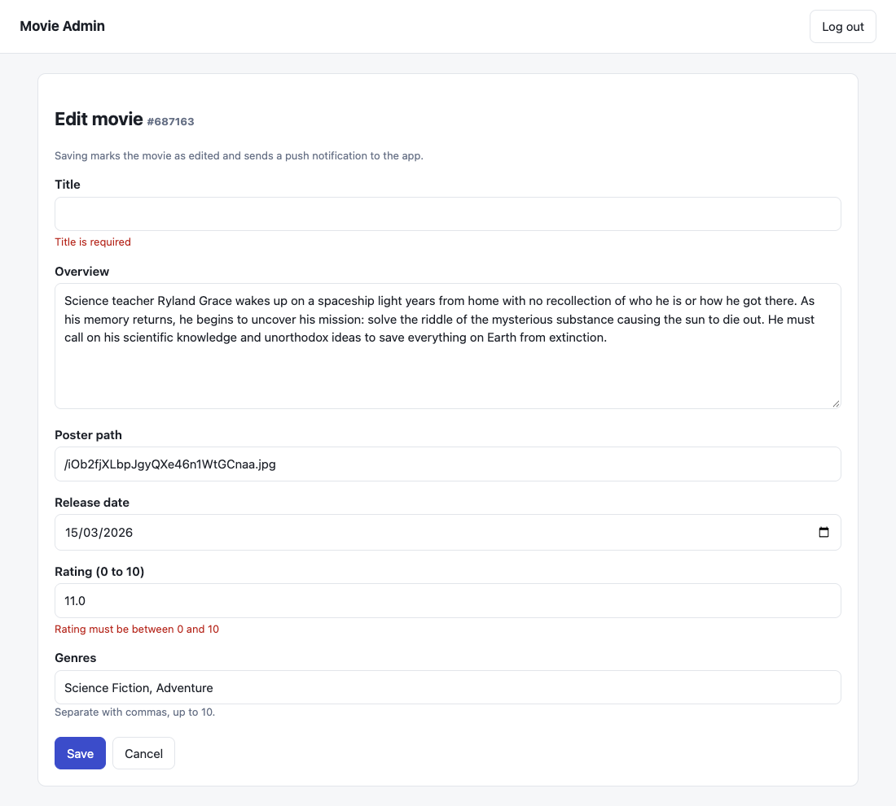

Opening a movie that does not exist goes back to the list with a red message:

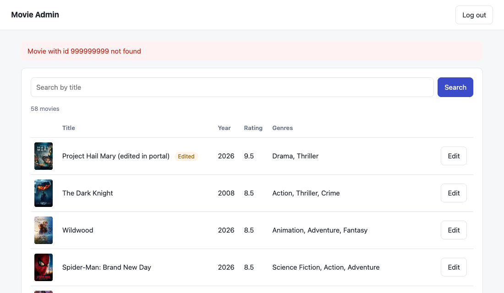

**6. Cancel** — **Cancel** goes back to the list and changes nothing.

**7. Sign out** — **Log out** (top right) ends the session and shows the login page.

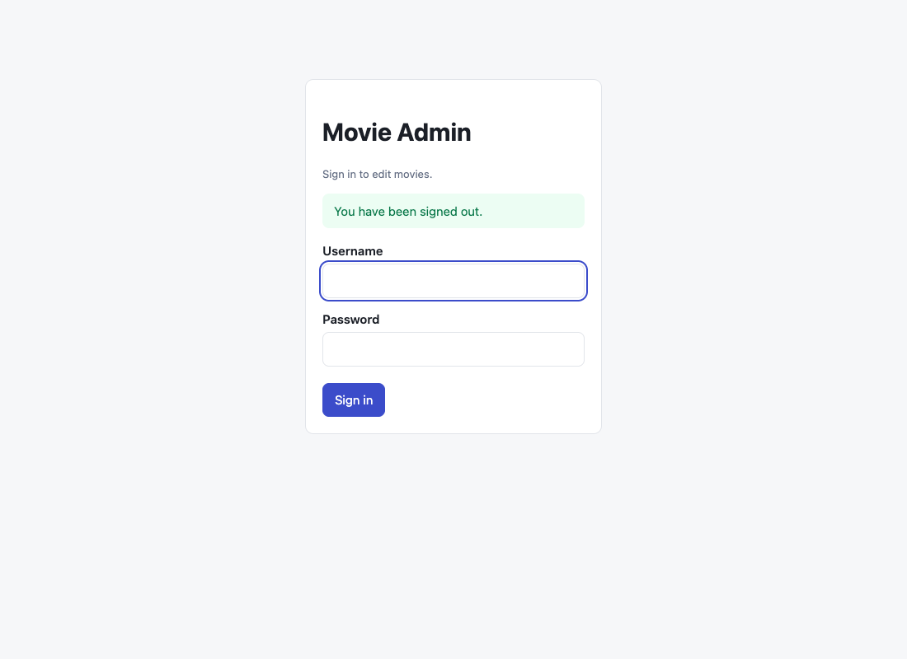

**Safety:** every form has a hidden CSRF token, so a form sent from another site is rejected (HTTP 403). Only the admin role can open `/admin/...`.

**What happens behind the scenes on Save:** the portal calls the same service as `PATCH /api/movies/{id}`. The values are cleaned (trimmed, repeated spaces removed) and compared with the stored ones. If something differs, the movie is saved, flagged as edited, and the push is sent after the save succeeded.

---

## 4. When is a push sent, and what does it contain?

### When

Only when an edit **really changes the content**. These count as *no change*, so nothing is saved and no push is sent:

- spaces at the start or end of a title, genre, overview or poster path
- repeated spaces inside a title or genre (`"Fight   Club"`)
- different line endings or trailing spaces in the overview
- an empty overview or poster path instead of a missing one
- the same genres in another order, or with blanks or duplicates
- the same rating (ignoring tiny rounding differences)

These **are** real changes: a different title (also capital letters), a new or removed genre, a different rating, date, overview or poster.

After a real change the movie is marked as *edited*, `updated_at` changes, and the push is sent **after** the database save succeeded. If sending fails, the edit still succeeds and the error is logged.

### What

A **data message** to the topic `movie-updates`. Each movie field is its own key. All values are strings.

| Key | Example | Notes |
|---|---|---|
| `type` | `MOVIE_UPDATED` | Always this value |
| `movie_id` | `550` | |
| `updated_at` | `2026-11-06T19:10:00Z` | |
| `updated_fields` | `title,vote_average` | Fields that really changed |
| `title` | `Fight Club (Edited)` | |
| `overview` | `A ticking-time-bomb...` | Left out if the movie has none |
| `poster_path` | `/pB8B.jpg` | Left out if none |
| `backdrop_path` | `/hZko.jpg` | Left out if none |
| `release_date` | `1999-10-15` | Left out if none |
| `vote_average` | `9.1` | |
| `vote_count` | `27000` | |
| `popularity` | `61.4` | |
| `genres` | `["Drama","Thriller"]` | JSON list of names |
| `partial` | `true` | Only present if the message was too big. Then `overview` is missing and the app should fetch the movie. |

A key that is missing means the movie has no value for it.

---

## 5. Android integration guide

Follow these steps to make the Android app use this backend instead of calling TMDb directly, and to update its local cache when a movie is edited. The steps describe *what* to do. Use your app's own libraries (this project assumes Ktor, Koin and Room) and its existing structure.

The app never edits movies. Edits are made in Swagger UI, Postman or the admin portal.

### Run the app against your local backend

1. Start the backend (section 1) and set up Firebase (section 2).
2. In Android Studio choose the build variant **`customDebug`**.
3. Run it on an emulator **with Google Play** (or a real phone). The emulator reaches your computer at `http://10.0.2.2:8080/api/`.
4. The movie list should load from the backend. The **`tmdbDebug`** variant keeps working without the backend.

### Configuration for the app

| What | Where it goes | Notes |
|---|---|---|
| Backend URL | `BASE_URL` of the `custom` flavor | `http://10.0.2.2:<API_PORT>/api/` on the emulator. Keep the trailing `/`. |
| Allowed plain-HTTP host | A network security config used only by the `custom` flavor | Only `10.0.2.2`. For a real phone add your computer's IP. |
| Firebase config | `app/google-services.json` | Must come from the **same Firebase project** as the backend. **Never commit it.** |
| Push topic | The name `movie-updates` | Must match the backend's `FCM_TOPIC` exactly. |
| TMDb API key | Not needed in the `custom` flavor | The backend holds the key. The `tmdb` flavor keeps your existing setup. |
| Admin login | Only for testing edits in Swagger UI or Postman | Never put it in the app. |

### Steps

1. **Know the address.** Emulator: `http://10.0.2.2:<port>/api/`. Real phone on the same Wi-Fi: `http://<computer IP>:<port>/api/`. The port is the backend's `API_PORT` (default 8080).

2. **Add a `custom` build flavor** next to the existing TMDb one, with its own `BASE_URL`. Keep the `tmdb` flavor working.

3. **Allow plain HTTP to `10.0.2.2`** in the `custom` flavor only. The local backend uses HTTP, which Android blocks by default.

4. **Add the models.** A movie, a page (`page`, `results`, `total_pages`, `total_results`) and the error body. Names are snake_case (use `@SerialName`). Turn on *ignore unknown keys* so new backend fields never crash the app. `overview`, `poster_path`, `backdrop_path` and `release_date` can be null.

5. **Add the API calls** (with Ktor): `GET movies`, `GET movies/search` and `GET movies/{id}`, with the `page`, `size` and `query` parameters from section 3. Treat every non-2xx answer as an error and map it to your domain errors:

   | Answer | Domain error |
   |---|---|
   | 404 | `NotFound` |
   | 400 | `Validation` |
   | 401 | `Unauthorized` (should not happen, the app never edits) |
   | 500 | `Server` |
   | No answer, timeout | `Network` |

6. **Plug it in without changing the domain layer.** Put the calls behind your existing remote data source interface and give each flavor its own Koin module (same module name in each flavor's source folder), so the shared code never knows which backend it uses. Map `genres` straight to the names your UI shows. Check: the list, paging and search load in `customDebug`.

7. **Connect Firebase.** Add the app to the backend's Firebase project (same package name as the `customDebug` build), download `google-services.json` into `app/`, apply the Google Services plugin and add the file to `.gitignore`.

8. **Subscribe to the topic** `movie-updates` when the app starts, in the `custom` flavor only. Calling it on every start is fine. You only need the notification permission (Android 13+) if you also show a visible notification. The data message arrives without it.

9. **Receive the push.** Add a Firebase messaging service (declared in the `custom` flavor's manifest). In `onMessageReceived`:
   1. Ignore the message unless `type` is `MOVIE_UPDATED`.
   2. If `partial` is `true`, fetch `GET movies/{movie_id}` (for example with a small WorkManager job) and save the result.
   3. Otherwise build the movie from the message keys (table in section 4; a missing key means no value; `genres` is a JSON list) and save it.
   4. Save to Room **only if** the incoming `updated_at` is the same or newer than the stored one. This stops a late or repeated push from bringing back old data.

   The service and the job are created by Android, not Koin, so they get their dependencies through `KoinComponent`.

10. **The screens update by themselves** if the list and the details screen read from Room. No extra UI code is needed.

11. **Test it.**
    1. Run `customDebug` on an emulator with Google Play. Check the list, paging and search.
    2. Put the app in the background.
    3. In Swagger UI click **Authorize** (`admin` / `admin123`) and call `PATCH /api/movies/{id}` with `{"title": "Test edit"}`.
    4. Check the backend log: `docker compose logs api | grep FCM` shows `FCM sent for movie ...`.
    5. Open the app. The new title is there without pull-to-refresh.
    6. Open that movie's details, stay in the app, and edit again. The title changes live.
    7. Send the same title again with extra spaces. No push is sent and nothing changes.

### Android problems

| Problem | Fix |
|---|---|
| `CLEARTEXT communication not permitted` | Step 3 is missing, or the IP is not in the config |
| Cannot connect from the emulator | Use `10.0.2.2` and the backend's `API_PORT`, not `localhost` |
| Cannot connect from a real phone | Use the computer's IP, same Wi-Fi, open the port in the firewall, add the IP in step 3 |
| No push arrives | Emulator without Google Play, app force-stopped, not subscribed to `movie-updates`, or the app and backend use different Firebase projects |
| Push arrives, nothing changes | `type` is not `MOVIE_UPDATED`, the incoming `updated_at` is older than the saved one, or the service is missing from the manifest |
| Overview is missing in the push | The movie has none, or `partial=true` — then fetch the movie |
| Images do not show | The path is relative. Put `https://image.tmdb.org/t/p/w500` in front |

---

## 6. Architecture and decisions

### How the system fits together

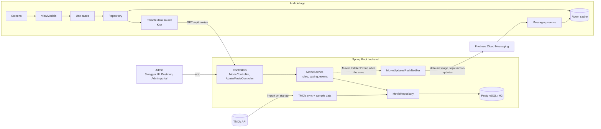

### What happens when an admin edits a movie

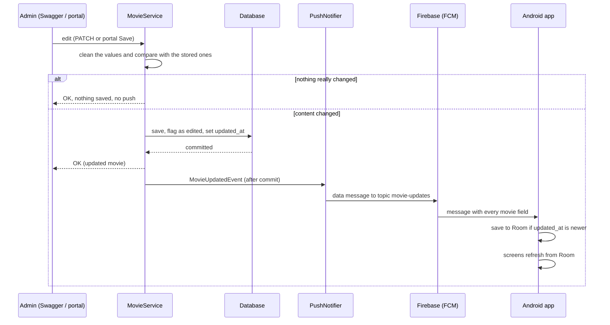

### Backend layers

| Layer | Package | Job |
|---|---|---|
| Controllers | `movie/`, `admin/` | Only HTTP: read the request, call the service, return JSON or a page |
| Service | `movie/MovieService` | The rules: paging limits, comparing old and new values, saving, announcing a change |
| Repository | `movie/MovieRepository` | Database access (Spring Data) |
| Data sources | `tmdb/`, `movie/seed/` | TMDb import and the sample movies |
| Notification | `notification/` | Builds the push message and sends it after the save |
| Cross-cutting | `config/`, `common/` | Security, Firebase, API docs, error format, paging envelope |

The API returns DTOs, never database entities.

### Android app layers

| Layer | Job |
|---|---|
| Screens (Compose) and ViewModels | Show data from Room. No network code |
| Use cases | The domain rules. **Unchanged** by this backend |
| Repository | Decides between Room and the remote data source |
| Remote data source (Ktor) | `tmdb` flavor talks to TMDb, `custom` flavor talks to this backend |
| Room | The single source of truth the screens read |
| Messaging service | Receives the push and writes the movie to Room |

### Decisions

Each decision says what we chose, why, and what it costs.

#### Backend

**Spring Boot with Kotlin.**
- *Why:* same language as the Android app, and Spring already provides paging, validation, security, the admin web pages and API docs, so there is little custom code.
- *Cost:* a heavier runtime than a small framework like Ktor.

**Our own database, filled from TMDb, instead of a pass-through proxy.**
- *Why:* edits must survive restarts, and search and paging are served from our data. The TMDb id is the primary key, so a re-sync updates the same row.
- *Cost:* data can be as old as the last sync. An edited movie gets an *edited* flag, and later syncs only refresh its popularity and vote count, so edits are never overwritten.

**Sample data when there is no TMDb key (or TMDb fails).**
- *Why:* a reviewer can run the project with no account. Sample ids start at 9000001 so they never clash with real TMDb ids.

**The TMDb key stays on the server.**
- *Why:* it is no longer inside the app (APK). The content filters (`include_adult=false`, US certification up to PG-13) are applied in the import.
- *Safety:* failed TMDb calls are logged without the URL, because the URL contains the key.

**Layers: controller → service → repository, and DTOs instead of database entities.**
- *Why:* the controller only handles HTTP, the service holds the rules, and the API shape can change without touching the database model. This mirrors the Android app's Clean Architecture.

**One error format for every failure** (`status`, `error`, `message`, `details`, `timestamp`).
- *Why:* the Android app maps the status to its own domain errors in one place. Unexpected errors return a generic message, and details stay in the server log.

**Two security setups in one app.**
- *Why:* the API is stateless with HTTP Basic, so a client gets a clean 401 and not a login page. The admin portal uses a login form with a session and CSRF protection, as browsers need. Reading movies is public because the app has no login.

**Push through a topic, as a data-only message.**
- *Why:* a topic needs no device registration or token storage. A data-only message always reaches the app's code (app open or in the background), so the app decides what to do.
- *Cost:* every installed app gets every update.

**The push is sent only after the database save succeeds.**
- *Why:* a rolled-back edit sends nothing, and the push can never arrive before the data is saved. A failed send is logged and never fails the edit. Without Firebase credentials it only logs.

**The push is sent only when the content really changes.**
- *Why:* extra spaces, a different genre order or sending the same values again would wake every phone for nothing. The service compares cleaned-up old and new values and skips the save and the push if they are the same.

**Every movie field is its own key and value in the push.**
- *Why:* FCM values must be strings, and flat keys are easy to read on Android without a nested object. A missing key means no value. `updated_fields` tells the app what changed.
- *Limit:* FCM allows 4 KB per message. If a message is too big, `overview` is dropped and `partial=true` is set, and the app fetches the movie.

**Firebase uses the plain Java HTTP transport.**
- *Why:* Spring upgrades an Apache HTTP library that made the Firebase SDK read FCM answers twice and fail with "Not in GZIP format".

**The admin portal lives in the same app and only edits.**
- *Why:* no separate frontend, and it reuses the same service, so the rules and the push are identical to the API. It cannot create or delete movies.

**Database tables are created automatically (`ddl-auto=update`).**
- *Why:* simple for this project. *Cost:* no migration history. Flyway migrations would be the next step for production.

#### Android app

- **Two build flavors, `tmdb` and `custom`.** The original TMDb setup keeps working, so anyone can run the app without the backend. Only the data layer differs.
- **One remote data source interface, one Koin module per flavor.** The domain layer and use cases do not change.
- **One error mapper.** Every failed call becomes a domain error in one place, so the UI is the same for both flavors.
- **Room is the single source of truth.** The UI reads only from Room. A push writes to Room, so the screens update with no extra UI code.
- **The push already contains the movie**, so the app can update Room without a network call. If the message is `partial`, the app fetches the movie instead.
- **Stale-data guard.** A row is overwritten only if the incoming `updated_at` is the same or newer.
- **Plain HTTP only for `10.0.2.2`, only in the `custom` flavor.** The release build keeps Android's default HTTPS-only rule.

---

## 7. Tests and project layout

Run the tests:

```bash
./gradlew test
```

```
src/main/kotlin/com/example/trianglzmoviebackend/
├── movie/          movies: entity, repository, service, controller, DTOs; seed/ = sample data
├── tmdb/           client/ = TMDb HTTP client, sync/ = import on startup
├── notification/   builds and sends the FCM push
├── admin/          admin portal (Thymeleaf)
├── config/         settings, security, Firebase, API docs
└── common/         error format, paging envelope, exception handler
postman/            Postman collection
api.http            ready-made requests
```

## 8. Troubleshooting

| Problem | Fix |
|---|---|
| `port is already allocated` | Set `API_PORT` / `DB_PORT` in `.env` and restart |
| Gradle says it cannot find a Java 17 installation (the message mentions `toolchain`) | Install JDK 17. Only a newer Java is not enough. Or use Docker, which needs no Java |
| App stops at startup with a file-not-found error for Firebase | `FIREBASE_CREDENTIALS_PATH` is wrong. Inside Docker use `/secrets/<file>`; without Docker use the real path or clear it |
| Log says `FCM log-only mode` | No Firebase credentials are set, so nothing is really sent |
| `TMDb sync failed ... HTTP 401` | Wrong `TMDB_API_KEY`. The app keeps running with sample data |
| Emulator cannot reach the API | Use `http://10.0.2.2:<API_PORT>/api/`, not `localhost` |
| Edit returns 401 | Wrong admin login |
| Edit returns 200 but no push | The content did not really change (see section 4) |
| Push is sent but the phone gets nothing | Emulator without Google Play, app force-stopped, or the app is in a different Firebase project |
